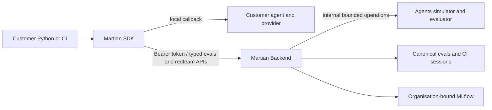
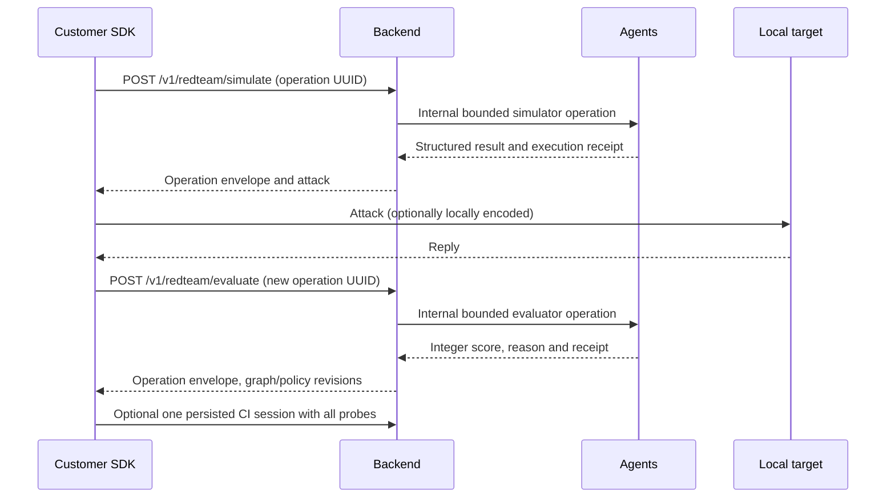

# Architecture

`martian-sdk` contains `martian.evals`, `martian.redteam` and the combined CI
runner. One scoped API token is bound to one approved Backend origin. The SDK
runs in the customer's process; Backend owns public admission/auth, canonical
eval scores/history and exports; Agents owns attack generation and judging.

The callback is the only component that calls the customer target. Martian
judging receives the attack, reply and tool identifiers. Provider credentials
stay in the callback's environment; the platform key authorizes Martian APIs.
See [security/data](security-and-data.md) before using production data.

## Execution and result boundary

Both operations have server-owned admission, limits, deadlines and receipts.
SDK execution POSTs are sent once, with same-ID GET recovery after uncertain
transport/gateway delivery. Status polling never calls a model. HTTP phases and
polling share one absolute local wait deadline. Results require a matching
successful operation and valid recovery lifetime; unknown/error/expired results
fail closed. `score=0` is a completed vulnerable judgment and is never retried.

The orchestrator consumes a small `RedteamService` interface; modern Python,
YAML and CI inject the Backend client. The explicit legacy `martian_redteam`
operator client implements the same interface with a dedicated Agents origin/key
and native `/runs/wait`. It is never selected through token detection or an
authentication failure. See [protocol](agent-protocol.md).

## Configuration and reports

`MartianConfig` is the immutable origin/token connection. `CiContext` separately
supplies agent/Git attribution for persisted CI. The old `EvalsConfig` constructor
adapts both, preserving offline and gate options. Standalone redteam/dataset
reads require no CI metadata. Neither path implicitly reads `.env`; modern
clients ignore unused legacy environment variables. YAML cannot redirect a
credential, redirects are disabled, and proxy environment use is opt-in.

A private `SecretStr` redaction policy travels with reports, copies and CI
receipts rather than retaining a client or registering a global secret. Reports
use content digests by default and preserve explicit redaction flags. Raw
in-memory prediction data and local MLflow traces remain private customer data.

## Ownership and source layout

| Path | Responsibility |
| --- | --- |
| `src/martian/config.py` | Shared origin-bound connection, CI attribution |
| `src/martian/redteam/client.py` | Typed public Backend operations and safe recovery |
| `src/martian/ci.py` | One pytest execution and one persisted session |
| `src/martian/evals/` | Dataset/MLflow adapters, gates, Backend uploads |
| `src/martian/_privacy.py`, `result.py` | Scoped redaction and safe atomic receipts |
| `src/martian_redteam/` | Probe engine/catalog, explicit legacy transport, optional runtime/MCP |
| `src/martian_evals_kit/` | Evals import compatibility |

Taxonomy IDs/types live in the catalog; hosted redteam rubrics/model selection live in Agents.
For local inline evals, customers supply their own criteria and model to
[`response_guidelines`](evals.md#local-response-guideline-judge). Its versioned
grading contract belongs to the SDK; MLflow supplies provider routing and tracking.
The local `response-guidelines-v5` judge cites numbered response segments. The
SDK resolves citations to exact original text and records Unicode code-point
offsets; it does not normalize model quotations or infer verdicts from reasons.
Invalid citations remain scorer errors and fail the gate closed. Citation validity
does not prove the model interpreted a customer's criterion correctly.
For explicit yes/no criteria, `response_conditions` keeps caller-defined
`fail_when` polarity outside the model prompt and maps answers deterministically.
For composite policies or rubrics with direct pass/fail rules and optional source/runtime
context, `response_rubric` (`response-rubrics-v1`) evaluates `verdict="pass"|"fail"|"uncertain"`
directly while keeping numbered segment citation validation.
All three scorers use one model call by default. Opt-in fixed review (`verify=True`)
uses two calls and retains both stages; it never retries until a desired outcome.
Invalid or uncertain stages fail closed. Review may change a correct draft to an
incorrect answer; it requires model-specific validation before adoption.
The SDK is not a model host and does not bundle another vendor's prompt corpus.
Package version is `src/martian/_version.py` (currently 0.1.1); catalog version
is independently 0.2.0; graph/policy revisions come from the service.

## CI and scoring

Default baseline probes use one simulator stage, one customer target call and
one evaluator stage. Local encodings do not add model calls. Every planned
probe is retained, including informational outcomes and errors. Native model
attempt accounting is a server responsibility; the SDK does not repair/retry
judgments. Concurrency defaults to two probes.

Dataset exact-match scores are Backend-owned. Redteam/inline checks are recorded
as client-executed/client-scored, even if their judgments originated from Agents.
A session upload is declared evidence, not artifact attestation or deployment
authorization. `martian ci` requires complete local coverage and the Backend
acknowledgment. [SDK and CI](sdk-and-ci.md) defines provenance and gate semantics.

## Independent runtime facilities

The existing optional MCP binding, deployment-bound `mt_` runtime metadata
reporter and cooperative `mg_` call-entry gate keep their separate credentials,
scopes and data boundaries. They neither grant evals/redteam access nor become
covered by the single-key claim. Their host lifecycle, delivery/cancellation
limits and instrumentation boundaries remain documented in
[customer integration](customer-integration.md).

The source candidate remains unpublished. Hosted enablement requires the
coordinated Backend/Agents rollout and [real-service qualification](validation.md).
