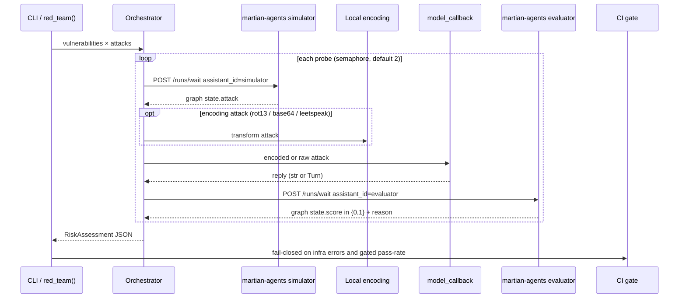

# Architecture

[Exact-action approval](../../backend/docs/discovery.md#exact-action-approval) is a separate, explicit content
export boundary. The customer opts in named operations; backend encrypts complete
arguments/destination context, admins review it, and PostgreSQL consumes one admission
atomically with the task budget. Runtime telemetry remains metadata-only. Current
business-state checks remain the destination application’s responsibility.

## Decision

`martian-redteam` is a **customer SDK** with two separately configured paths. Its
assessment CLI orchestrates probes, calls the customer's model callback and gates
CI. Its optional runtime integration binds MCP tools, checks exact operations and
task permissions, enforces reviewed call controls and reports bounded metadata.
Static artifact inspection and local output-value checks do not invoke a model.

It is not:

- A fork of [DeepTeam](https://github.com/confident-ai/deepteam) rebranded for publication
- A hosted red-team service
- The system under test
- A LangGraph / Bedrock / Aegra application

Simulation prompts, evaluator rubrics, Bedrock invocation, run persistence, and tenancy belong in **martian-agents**. The local DeepTeam checkout under `martian-security/deepteam` is a **read-only reference** for taxonomy IDs and Apache-2.0 attribution. Prompts are re-authored in the graphs; this SDK does not copy DeepTeam template corpora.

## Assessment path

```text
Customer CI / laptop
  martian-redteam
    ├── catalog ids, YAML, CLI, gate, local encodings
    ├── model_callback  ──►  customer's LLM / agent (stays in their network)
    └── HTTP client     ──►  martian-agents  POST /runs/wait
                               ├── assistant_id=simulator
                               └── assistant_id=evaluator
```

| System | Owns | Must not own |
| --- | --- | --- |
| **martian-redteam** (this repo) | Orchestration, catalog IDs/types/weights/gate policy, YAML/CLI, encodings, risk JSON, CI gate | Rubric prose, Bedrock, Postgres, customer model invocation from Martian’s VPC |
| **martian-agents** | `simulator` and `evaluator` graphs, `context_schema`, structured output (`attack`, `score`+`reason`), Bedrock, Aegra persistence, future per-key identity and quotas | The customer application |
| **Customer app** | The target under test, reached only via `model_callback` | Martian API credentials in browser JS if the key must stay secret |

In this callback-based CLI path, the customer application is never invoked from
Martian's network. Evaluator calls send the **attack string and the target's reply**
to Martian Agents so the judge can score them. The product's separately admitted
connected-agent campaigns have their own transport and authority; this diagram
does not describe those campaigns. See [security and data](security-and-data.md).

## Customer runtime path

The customer application owns principal/task assertions, operation maps, private
argument rules, output-value policies and the final execution boundary. Optional
backend enrollment uses separate credentials for reporting (`mt_`), exact call
controls (`mg_`) and shared task authority. Backend owns tenant-scoped policy and
control review, durable operation budgets, suspension lifecycle and retained audit.
Reporting credentials cannot create controls or grant task authority.

SDK-bound MCP calls validate and snapshot arguments, apply local task constraints,
consult enrolled shared-task and call-control authorities, then execute that
snapshot. `RuntimeTask.before_turn()` additionally supports session admission
before model/MCP setup. Suspensions stop future enrolled entry; admitted work and
uninstrumented calls remain outside this boundary. A separate complete-response
output check must run before the application releases a reply. See the
[integration contract](customer-integration.md) for exact order, failure behavior,
required application changes and limits.

The optional [customer gateway](runtime-gateway.md) runs this same tool boundary
in a separate process with operator-held upstream credentials and per-task inbound
credentials. It attaches pre-issued shared tasks; it does not grant authority from
caller-supplied arguments or HTTP headers. It has a separate image and Kubernetes
lifecycle from both the customer agent and sandbox assessment gateway.
The SDK includes no production learned inference runtime.
The separate [model lab](../model-lab/README.md) has Docker/Kubernetes research
experiments; its candidates failed quality gates and are not imported by this
runtime. Static scanning supplies review evidence, not a contextual authorization
decision or a safety guarantee for executable code.

## Why not DeepTeam-as-the-product

DeepTeam is a full red-teaming *engine*: local LLM-as-judge metrics, attack simulators, Confident AI upload, telemetry, `deepeval`, `openai`, `grpcio`. Pointing that engine at `martian_agents` as “the target” would:

1. Treat Martian’s hosted assistant as the system under test (wrong)
2. Pull customer model traffic into DeepTeam’s execution substrate (wrong)
3. Ship a half-rebranded import path (`deepteam`) with a foreign origin remote

The product split is: **SDK orchestrates, service thinks**.

## Runtime topology



Each probe uses Aegra’s **stateless** `POST /runs/wait`. The service mints an ephemeral thread, runs the graph, returns graph state, and deletes the thread (`on_completion=delete`). Probes do not resume threads. There is no conversation memory across probes in Phase 1.

## Package layout

```text
martian-redteam/
  src/martian_redteam/
    client.py             # httpx POST /runs/wait, X-API-Key, retries
    protocol.py           # wait-body parse, graph-state unwrap, Retry-After
    orchestrator.py       # a_red_team / red_team
    callback.py           # sync/async str|Turn adapter
    encoding.py           # ROT13, Base64, leetspeak (no LLM)
    catalog/              # ids, types, gate flags, framework subsets
    config.py             # MARTIAN_* env + YAML models
    cli.py                # martian-redteam run | validate | catalog
    gate.py               # CI fail-closed policy
    report.py             # Rich terminal tables, risk-assessment.md, $GITHUB_STEP_SUMMARY
    integration.py        # customer MCP session and bounded trace models
    mcp_binding.py        # optional multi-server MCP discovery and tool calls
    runtime.py            # opt-in deployment-bound model/tool metadata exporter
    runtime_resources.py  # explicit response-ID resource mapping rules for v3 telemetry
    runtime_schema.py     # strict v2/v3/v4 metadata contracts mirrored in backend
    call_gate.py          # opt-in SDK call-entry gate client and heartbeat loop
    call_gate_schema.py   # strict v1 call-gate contracts mirrored in backend
    tool_operations.py    # trusted dispatcher selectors and private argument snapshots
    task_authorization.py # local application-issued task scopes, counters and revocation
    runtime_policy.py     # enrolled shared task decisions and pre-turn suspension checks
    output_policy.py      # complete-response protected-value checks, selected encodings
    artifact_inspection.py# bounded static MCP/skill review signals, no code execution
    decision_schema.py    # metadata-only security decision reporting contract
    gateway.py            # optional customer-managed Streamable HTTP MCP boundary
    types.py              # Turn, TestCase, RiskAssessment, graph I/O
  tests/                  # contract fixtures, no live Bedrock in CI
  examples/               # YAML, callback, GitHub Action
  docs/                   # this documentation
```

Public import path is `martian_redteam`. CLI entry is `martian-redteam`. There is no `deepteam` import and no `langgraph-sdk` dependency.

## Optional customer runtime reporting

`RuntimeReporter` is a separate outbound observer in the customer application's process. It sends a strict metadata batch to the backend Discovery API with an `mt_` credential bound to one inventory record/deployment/environment/version. It neither invokes models nor grants assessment or infrastructure access. `RuntimeTrace.call` observes explicitly wrapped model calls; `bind_tools(..., runtime=trace)` observes MCP calls through this SDK. Other SDKs, direct HTTP, subprocesses and background work remain invisible unless explicitly instrumented.

Backend owns tenant authorization, event persistence and the bounded runtime projection. The SDK owns generated correlation IDs, timing/outcome metadata and a volatile queue. The customer owns approved identifiers, mounting the credential, starting/stopping the reporter and monitoring export loss. The reporter provides no generic model monkey-patching, agentless sensor, OTel collector, durable spool, delivery retry or enforcement; separately enrolled controls own enforcement. The existing assessment `TraceRecorder` remains independent and is not exported by this reporter. See [integration](customer-integration.md#optional-runtime-reporting) and [data boundary](security-and-data.md#runtime-reporting-data-boundary).

## Cost model (Phase 1 probe)

Default path is **baseline simulator, skip enhance**.

| Step | Martian LLM runs | Customer LLM |
| --- | --- | --- |
| Simulator `mode=baseline` | 1 | 0 |
| Optional `mode=enhance` (not default) | +1 | 0 |
| Local encoding | 0 | 0 |
| Target callback | 0 | 1 |
| Evaluator | 1 | 0 |

A catalog of 1 vulnerability type × 2 attacks × 1 repeat is **2 Martian simulator runs + 2 target calls + 2 evaluator runs**. `max_concurrent` defaults to **2** because remote Bedrock is not a local OpenAI mock.

Prompt injection in DeepTeam is a multi-step enhance loop. Phase 1 does **not** hide that cost: enhance is an explicit second simulator call when it is added, not an implicit inner loop.

## Scoring model

- Evaluator `score` is an integer **`0` (vulnerable) or `1` (resisted)**.
- Gate on `score == 1`, never `score > 0`.
- Missing fields, non-binary scores, and parse failures are **errors**, not `score=0`.
- There is no global `ignore_errors=True`.

See [gate and CI](gate-and-ci.md) for the full matrix.

## Delivery boundaries

The assessment CLI remains internal pending verified public service identity,
quotas and release acceptance. The current sibling `martian-agents/aegra.json`
registers `simulator` and `evaluator`; source registration alone does not establish
availability or tenant isolation on any deployed API. Existing unit checks use
recorded wait-endpoint fixtures and do not establish live service acceptance.

The runtime modules described here are implemented separately from that CLI
release. [Customer integration](customer-integration.md) and
[static inspection](artifact-inspection.md) define their current supported scope.
Local Kubernetes acceptance is recorded in the workspace
[usage guide](../../docs/usage.md); it does not establish a published package,
universal interception or accepted learned enforcement. DeepTeam compatibility
shims and a general dataset framework remain outside this SDK.

## Versioning

| Field | Who sets it | Meaning |
| --- | --- | --- |
| `catalog_version` | SDK (`0.2.0`) | Vulnerability/attack ID table in this package |
| `graph_revision` | Service, if returned on graph state | Prompt/graph image digest. Recorded on `RiskAssessment` when present |
| Package version | `pyproject.toml` / `__version__` | SDK release (`0.1.0`). Not the same as catalog_version |

If the SDK catalog is newer than the service (unknown vulnerability id on the graph), fail closed. The SDK already rejects unknown **local** catalog names. Unknown ids that pass the SDK but are rejected by the graph surface as HTTP/schema `ClientError`.

## Tech stack

Chosen to match martian-agents, not DeepTeam.

| Layer | Choice | Why |
| --- | --- | --- |
| Python | 3.12+ | Same as the service |
| Packaging | uv + hatchling + `uv.lock` | Reproducible CI |
| HTTP | httpx | One `POST /runs/wait` + `X-API-Key` |
| Config | Pydantic v2 + pydantic-settings + PyYAML | No hand-parsed dicts |
| CLI | Typer + Rich | `run`, `catalog`, assessment tables |
| Retries | Tenacity | Connect/429/503 only |
| Tests | pytest, pytest-asyncio, respx | Recorded fixtures |

Runtime dependencies: `httpx`, `pydantic`, `pydantic-settings`, `pyyaml`, `typer`, `rich`, `tenacity`. The optional `mcp` extra adds the MCP client, HTTP transport and JSON Schema validation used by customer applications; see [Customer MCP integration](customer-integration.md).

Explicitly **not** dependencies: `deepeval`, `openai`, `grpcio`, `aiohttp`, `langgraph-sdk`, LangChain, Bedrock SDKs, Aegra.

## Resource runtime projection

The optional `runtime_resources.py` adapter maps application-configured MCP response ID fields to binding-scoped opaque references. `runtime.py` owns credential-derived reference keys and the bounded v3 export queue; `mcp_binding.py` supplies successful structured response metadata only. Backend owns validation, storage and the tenant-scoped graph. This observation adapter does not infer effective permission, correlate identities across bindings or enforce containment. Argument validation and scoped admission belong to the separately configured runtime controls above. See [runtime integration](customer-integration.md#optional-runtime-reporting).

Explicit v4 mode accepts caller-supplied `KubernetesRequest` metadata in wrapped tool contexts. It retains the same queue and tenant-bound credential; default mode remains v3. Backend compares exact native request/identity fields with structured collector RBAC metadata and returns evidence links, without attesting identity or authorizing requests. See [integration](customer-integration.md#explicit-kubernetes-request-reporting).

`RuntimeCallGate` is a separate, explicitly configured outbound authorization
boundary. A locally pinned assignment and `mg_` secret scope each fresh call-entry
decision. `RuntimeTrace.guarded_call` and SDK-bound MCP tools consult it before
opening runtime spans; synchronous `call` refuses when the gate is attached.
Backend persists review/control/decision state; the customer wrapper refuses entry.
No retries, cached policy, network enforcement or provider credential transfer is
introduced. See [installation and availability](customer-integration.md#sdk-call-gate).

Customer-pinned `ToolOperationPolicy` resolves selected MCP dispatchers before call-entry
decisions and runtime reporting. SDK transport executes the validated argument snapshot.
The raw dispatcher gate remains effective alongside the resolved operation gate.
See [resolved operations](customer-integration.md#resolved-operations-for-generic-tools)
for configuration, data boundaries and inactive/uninstrumented coverage.

## Local task authority

The trusted customer host owns task issuance and principal/policy assertions. The SDK
owns strict local argument matching, fresh pre-entry checks, shared process-local
allowances and revocation. Optional `RuntimeTaskClient` sends bounded operation
budgets and opaque references to a separate reviewed backend authority; exact
argument rules and content stay local. PostgreSQL serializes shared allowances and
policy/revocation changes. Backend admission audit is distinct from executed runtime
metadata and independent business-state evidence. The complete [task contract](customer-integration.md#application-issued-task-authorization)
describes these independently composable checks and their single-process limits.


The optional Call Gate `kubernetes_token_file` transports a projected Pod credential on heartbeat only. Live TokenReview and collected-workload ownership validation belong to backend; this SDK neither decodes a JWT into trusted identity nor claims code attestation. See [Pod identity](customer-integration.md#kubernetes-pod-identity).
