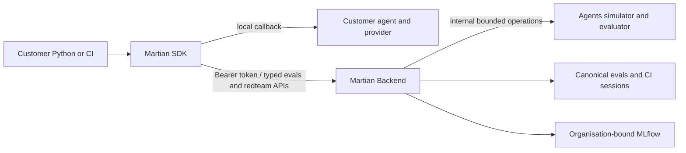
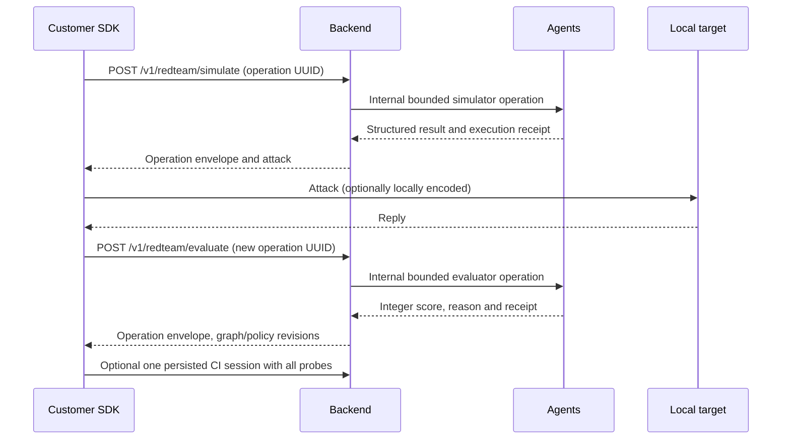

# Architecture

`martian-sdk` contains `martian.evals`, `martian.redteam` and the combined CI
runner. One scoped API token is bound to one approved Backend origin. The SDK
runs in the customer's process; Backend owns public admission/auth, canonical
eval scores/history and exports; Agents owns attack generation and judging.

The callback is the only component that calls the customer target. Martian
judging receives the attack, reply and tool identifiers. Provider credentials
stay in the callback's environment; the platform key authorizes Martian APIs.
See [security/data](security-and-data.md) before using production data.

## Execution and result boundary

Both operations have server-owned admission, limits, deadlines and receipts.
SDK execution POSTs are sent once, with same-ID GET recovery after uncertain
transport/gateway delivery. Status polling never calls a model. HTTP phases and
polling share one absolute local wait deadline. Results require a matching
successful operation and valid recovery lifetime; unknown/error/expired results
fail closed. `score=0` is a completed vulnerable judgment and is never retried.

The orchestrator consumes a small `RedteamService` interface; modern Python,
YAML and CI inject the Backend client. The explicit legacy `martian_redteam`
operator client implements the same interface with a dedicated Agents origin/key
and native `/runs/wait`. It is never selected through token detection or an
authentication failure. See [protocol](agent-protocol.md).

## Configuration and reports

`MartianConfig` is the immutable origin/token connection. `CiContext` separately
supplies agent/Git attribution for persisted CI. The old `EvalsConfig` constructor
adapts both, preserving offline and gate options. Standalone redteam/dataset
reads require no CI metadata. Neither path implicitly reads `.env`; modern
clients ignore unused legacy environment variables. YAML cannot redirect a
credential, redirects are disabled, and proxy environment use is opt-in.

A private `SecretStr` redaction policy travels with reports, copies and CI
receipts rather than retaining a client or registering a global secret. Reports
use content digests by default and preserve explicit redaction flags. Raw
in-memory prediction data and local MLflow traces remain private customer data.

## Ownership and source layout

| Path | Responsibility |
| --- | --- |
| `src/martian/config.py` | Shared origin-bound connection, CI attribution |
| `src/martian/redteam/client.py` | Typed public Backend operations and safe recovery |
| `src/martian/ci.py` | One pytest execution and one persisted session |
| `src/martian/evals/` | Dataset/MLflow adapters, gates, Backend uploads |
| `src/martian/evals/model/` | The shared eval data model; see [eval model](eval-model.md) |
| `src/martian/evals/server/`, `src/martian/evals/store/` | The evals core and its store interface; see [evals core](evals-core.md) |
| `src/martian/evals/records/` | The evals core's own records on SQLite or Postgres, their migrations and change events, and the worker's queue |
| `src/martian/_privacy.py`, `result.py` | Scoped redaction and safe atomic receipts |
| `src/martian_redteam/` | Probe engine/catalog, explicit legacy transport, optional runtime/MCP |
| `src/martian_evals_kit/` | Evals import compatibility |

Taxonomy IDs/types live in the catalog; hosted redteam rubrics/model selection live in Agents.
For local inline evals, customers supply their own criteria and model to
[`response_guidelines`](evals.md#local-response-guideline-judge). Its versioned
grading contract belongs to the SDK; MLflow supplies provider routing and tracking.
The local `response-guidelines-v5` judge cites numbered response segments. The
SDK resolves citations to exact original text and records Unicode code-point
offsets; it does not normalize model quotations or infer verdicts from reasons.
The SDK invokes direct chat completions using MLflow provider routing, rejects
tool requests before dispatch, and validates the full judgment before scoring.
Invalid citations remain scorer errors and fail the gate closed. Citation validity
does not prove the model interpreted a customer's criterion correctly.
For explicit yes/no criteria, `response_conditions` keeps caller-defined
`fail_when` polarity outside the model prompt and maps answers deterministically.
For composite policies or rubrics with direct pass/fail rules and optional source/runtime
context, `response_rubric` (`response-rubrics-v1`) evaluates `verdict="pass"|"fail"|"uncertain"`
directly while keeping numbered segment citation validation.
All three scorers use one model call by default. Opt-in fixed review (`verify=True`)
uses two calls and retains both stages; it never retries until a desired outcome.
A stage re-sends its request only when the provider returned no judgment: a rate limit,
for up to `rate_limit_wait_seconds` as the provider's `Retry-After` asks, or a server error
or connection failure, up to `max_retries` times with backoff.
Invalid or uncertain stages fail closed. Review may change a correct draft to an
incorrect answer; it requires model-specific validation before adoption.
The SDK is not a model host and does not bundle another vendor's prompt corpus.
Package version is `src/martian/_version.py`; catalog version
is independent (`CATALOG_VERSION`); graph/policy revisions come from the service.

## Open-source evals core

This repository is the home of the open-source evals core. The names stay as they are: the
repository `martian-redteam`, the PyPI distribution `martian-sdk`, the import package `martian`
and the command `martian`. Everything here is Apache-2.0, except `src/martian/ui/`: a build of the
Evals app from the private frontend, whose packages carry no licence yet
(MorningHQ/martian-notes#220). Paid Enterprise features live in the private Martian backend and
console, which use the core; this repository holds no commercially licensed code. The repository is private until the open-source launch.

The core grows into this layout. Paths marked as planned do not exist yet; the issue named
next to each one creates it.

| Path | Holds | Status |
| --- | --- | --- |
| `src/martian/evals/` | SDK: suite runner, suite file to and from the model, judges, checks, gate | Exists |
| `src/martian/evals/model/` | Shared eval data model used by the SDK and the server ([eval model](eval-model.md)) | Exists |
| `src/martian/evals/server/` | Evals core: API routers and services, identity and tenancy injected ([evals core](evals-core.md)) | Exists: the read and write routes |
| `src/martian/evals/store/` | Store interface with in-process and REST bindings on `mlflow-skinny` | The interface, the in-memory reference store and the in-process `mlflow-skinny` binding (SQLite and Postgres) exist; the server's REST binding is MorningHQ/martian-notes#105 |
| `src/martian/evals/records/` | The core's own records (runs, results, scores, reviews, suites, drafts, saved views) and the worker's queue, portable to SQLite and Postgres | Exists |
| `src/martian/evals/local.py` | The local edition behind `martian ui`: the core on SQLite for one user with no login, the session call and the built UI from one process ([evals core](evals-core.md#the-local-edition-martian-ui)) | Exists |
| `src/martian/evals/local_targets.py` | The local edition's targets in place of an Agents registry: an HTTP endpoint or an OpenAI-compatible model, with the user's key in a file only the user can read, and their `/v1/local/targets` routes ([local targets](evals-core.md#local-targets)) | Exists |
| `src/martian/evals/local_runs.py` | The local edition's worker, which runs each run started in the UI in a process of its own against a local target and scores it with its suite, the `/v1/local/runs` launch and run again ([local runs](evals-core.md#local-runs)), its runs and scoring jobs queued durably in the data folder, and the holds that let `martian ui` take again a run whose `martian ui` stopped, or finish one whose `martian evals run` stopped ([runs whose process stopped](evals-core.md#runs-whose-process-stopped)) | Exists |
| `src/martian/evals/run_record.py` | `martian evals run` recording each suite-file run through the store and the record store, so `martian ui` shows it ([command-line runs](evals-core.md#command-line-runs)) | Exists |
| `Dockerfile` | The local edition as an image for one user on a small server, with no login ([evals core](evals-core.md#the-local-edition-in-a-container)) | Exists; a release builds it from the wheel it publishes and pushes it to GitHub Container Registry ([releasing](releasing.md#the-local-editions-image)) |
| `src/martian/evals/worker/` | The worker interface the write routes hand runs and scoring jobs to, and the work itself ([the worker](evals-core.md#the-worker)) | Exists: one process per run (`ProcessWorker`) and a one-organisation in-process worker; HTTP targets called by the worker itself, with credentials from its own process, and registered agents through a martian-agents executor interface; and a durable queue in the record store's database (`QueueWorker`), whose worker serves beside the app or in a process of its own, so that a restart loses no queued or running run. The Martian server's worker process is MorningHQ/martian-notes#139's backend part |
| `src/martian/ui/` | The built Evals UI, shipped in the wheel; `martian ui` serves it by default. A build of the Evals app, whose source is in MorningHQ/MartianFrontend (`packages/`), pinned in `pyproject.toml` ([releasing](releasing.md#the-evals-ui-in-the-wheel)) | Exists |

## CI and scoring

Default baseline probes use one simulator stage, one customer target call and
one evaluator stage. Local encodings do not add model calls. Every planned
probe is retained, including informational outcomes and errors. Native model
attempt accounting is a server responsibility; the SDK does not repair/retry
judgments. Concurrency defaults to two probes.

Dataset exact-match scores are Backend-owned. Redteam/inline checks are recorded
as client-executed/client-scored, even if their judgments originated from Agents.
A session upload is declared evidence, not artifact attestation or deployment
authorization. `martian ci` requires complete local coverage and the Backend
acknowledgment. [SDK and CI](sdk-and-ci.md) defines provenance and gate semantics.

## Independent runtime facilities

The existing optional MCP binding, deployment-bound `mt_` runtime metadata
reporter and cooperative `mg_` call-entry gate keep their separate credentials,
scopes and data boundaries. They neither grant evals/redteam access nor become
covered by the single-key claim. Their host lifecycle, delivery/cancellation
limits and instrumentation boundaries remain documented in
[customer integration](customer-integration.md).

These facilities are integration extras, not a Martian product line.

The package is published on PyPI. Hosted use requires the SDK APIs to be enabled
on the Backend and Agents services for the organisation; see
[real-service qualification](validation.md).
