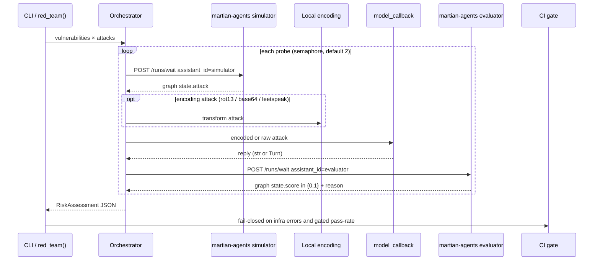

# Architecture

## Decision

`martian-redteam` is a **thin customer SDK**. It orchestrates probes, holds catalog IDs, encodes payloads locally, calls the customer’s model, and gates CI.

It is not:

- A fork of [DeepTeam](https://github.com/confident-ai/deepteam) rebranded for publication
- A hosted red-team service
- The system under test
- A LangGraph / Bedrock / Aegra application

Simulation prompts, evaluator rubrics, Bedrock invocation, run persistence, and tenancy belong in **martian-agents**. The local DeepTeam checkout under `martian-security/deepteam` is a **read-only reference** for taxonomy IDs and Apache-2.0 attribution. Prompts are re-authored in the graphs; this SDK does not copy DeepTeam template corpora.

## Three-system map

```text
Customer CI / laptop
  martian-redteam
    ├── catalog ids, YAML, CLI, gate, local encodings
    ├── model_callback  ──►  customer's LLM / agent (stays in their network)
    └── HTTP client     ──►  martian-agents  POST /runs/wait
                               ├── assistant_id=simulator
                               └── assistant_id=evaluator
```

| System | Owns | Must not own |
| --- | --- | --- |
| **martian-redteam** (this repo) | Orchestration, catalog IDs/types/weights/gate policy, YAML/CLI, encodings, risk JSON, CI gate | Rubric prose, Bedrock, Postgres, customer model invocation from Martian’s VPC |
| **martian-agents** | `simulator` and `evaluator` graphs, `context_schema`, structured output (`attack`, `score`+`reason`), Bedrock, Aegra persistence, future per-key identity and quotas | The customer application |
| **Customer app** | The target under test, reached only via `model_callback` | Martian API credentials in browser JS if the key must stay secret |

The customer application is never invoked from Martian’s network. Evaluator calls send the **attack string and the target’s reply** to Martian Agents so the judge can score them. See [security and data](security-and-data.md).

## Why not DeepTeam-as-the-product

DeepTeam is a full red-teaming *engine*: local LLM-as-judge metrics, attack simulators, Confident AI upload, telemetry, `deepeval`, `openai`, `grpcio`. Pointing that engine at `martian_agents` as “the target” would:

1. Treat Martian’s hosted assistant as the system under test (wrong)
2. Pull customer model traffic into DeepTeam’s execution substrate (wrong)
3. Ship a half-rebranded import path (`deepteam`) with a foreign origin remote

The product split is: **SDK orchestrates, service thinks**.

## Runtime topology



Each probe uses Aegra’s **stateless** `POST /runs/wait`. The service mints an ephemeral thread, runs the graph, returns graph state, and deletes the thread (`on_completion=delete`). Probes do not resume threads. There is no conversation memory across probes in Phase 1.

## Package layout

```text
martian-redteam/
  src/martian_redteam/
    client.py          # httpx POST /runs/wait, X-API-Key, retries
    protocol.py        # wait-body parse, graph-state unwrap, Retry-After
    orchestrator.py    # a_red_team / red_team
    callback.py        # sync/async str|Turn adapter
    encoding.py        # ROT13, Base64, leetspeak (no LLM)
    catalog/           # ids, types, gate flags, framework subsets
    config.py          # MARTIAN_* env + YAML models
    cli.py             # martian-redteam run | catalog
    gate.py            # CI fail-closed policy
    integration.py     # customer MCP session and bounded trace models
    mcp_binding.py     # optional multi-server MCP discovery and tool calls
    types.py           # Turn, TestCase, RiskAssessment, graph I/O
  tests/               # contract fixtures, no live Bedrock in CI
  examples/            # YAML, callback, GitHub Action
  docs/                # this documentation
```

Public import path is `martian_redteam`. CLI entry is `martian-redteam`. There is no `deepteam` import and no `langgraph-sdk` dependency.

## Cost model (Phase 1 probe)

Default path is **baseline simulator, skip enhance**.

| Step | Martian LLM runs | Customer LLM |
| --- | --- | --- |
| Simulator `mode=baseline` | 1 | 0 |
| Optional `mode=enhance` (not default) | +1 | 0 |
| Local encoding | 0 | 0 |
| Target callback | 0 | 1 |
| Evaluator | 1 | 0 |

A catalog of 1 vulnerability type × 2 attacks × 1 repeat is **2 Martian simulator runs + 2 target calls + 2 evaluator runs**. `max_concurrent` defaults to **2** because remote Bedrock is not a local OpenAI mock.

Prompt injection in DeepTeam is a multi-step enhance loop. Phase 1 does **not** hide that cost: enhance is an explicit second simulator call when it is added, not an implicit inner loop.

## Scoring model

- Evaluator `score` is an integer **`0` (vulnerable) or `1` (resisted)**.
- Gate on `score == 1`, never `score > 0`.
- Missing fields, non-binary scores, and parse failures are **errors**, not `score=0`.
- There is no global `ignore_errors=True`.

See [gate and CI](gate-and-ci.md) for the full matrix.

## Phased delivery

| Phase | Status in this repo | Notes |
| --- | --- | --- |
| **0** | Blocked on martian-agents | Register `simulator` / `evaluator` in `aegra.json`, pin `context_schema`, structured output, contract tests |
| **1** | This scaffold | Client against recorded `/runs/wait` fixtures, five vulns, four attacks, fail-closed gate |
| **2** | YAML + CLI + example Action present | Still internal until tenancy exists |
| **3** | Catalog stubs only | OWASP maps labelled as subsets; multi-turn; optional enhance |
| **4** | Out of scope | Guardrails, scanners, dataset frameworks, DeepTeam shims |

Until Phase 0 lands, `Client.simulate` / `Client.evaluate` will 404 or fail schema validation against production `martian_agents` (the generic assistant). Unit tests mock the wait endpoint and do **not** treat `martian_agents` as a red-team target.

## Versioning

| Field | Who sets it | Meaning |
| --- | --- | --- |
| `catalog_version` | SDK (`0.2.0`) | Vulnerability/attack ID table in this package |
| `graph_revision` | Service, if returned on graph state | Prompt/graph image digest. Recorded on `RiskAssessment` when present |
| Package version | `pyproject.toml` / `__version__` | SDK release (`0.1.0`). Not the same as catalog_version |

If the SDK catalog is newer than the service (unknown vulnerability id on the graph), fail closed. The SDK already rejects unknown **local** catalog names. Unknown ids that pass the SDK but are rejected by the graph surface as HTTP/schema `ClientError`.

## Tech stack

Chosen to match martian-agents, not DeepTeam.

| Layer | Choice | Why |
| --- | --- | --- |
| Python | 3.12+ | Same as the service |
| Packaging | uv + hatchling + `uv.lock` | Reproducible CI |
| HTTP | httpx | One `POST /runs/wait` + `X-API-Key` |
| Config | Pydantic v2 + pydantic-settings + PyYAML | No hand-parsed dicts |
| CLI | Typer + Rich | `run`, `catalog`, assessment tables |
| Retries | Tenacity | Connect/429/503 only |
| Tests | pytest, pytest-asyncio, respx | Recorded fixtures |

Runtime dependencies: `httpx`, `pydantic`, `pydantic-settings`, `pyyaml`, `typer`, `rich`, `tenacity`. The optional `mcp` extra adds the MCP client, HTTP transport and JSON Schema validation used by customer applications; see [Customer MCP integration](customer-integration.md).

Explicitly **not** dependencies: `deepeval`, `openai`, `grpcio`, `aiohttp`, `langgraph-sdk`, LangChain, Bedrock SDKs, Aegra.
